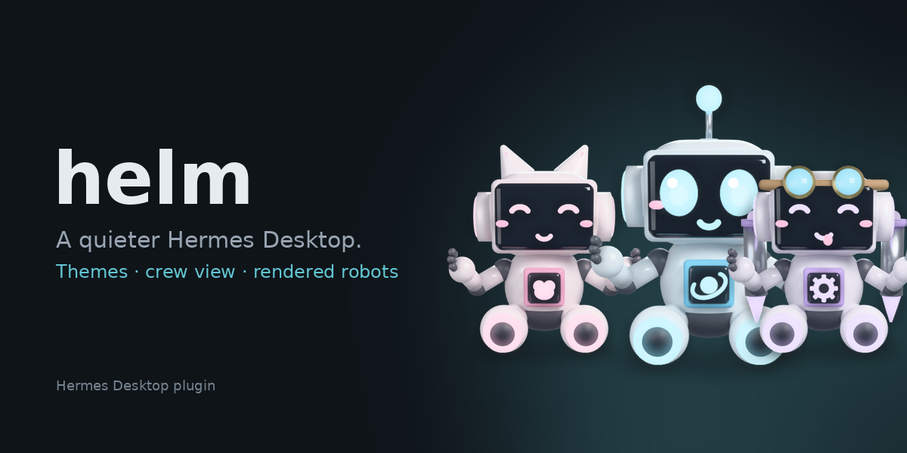

# helm

A quieter Hermes Desktop, as a plugin. Same app, same rail, same sidebar — helm changes how it looks and adds three things Hermes doesn't show you: what's working, what the session costs, and a Bots board where every bot is a rendered little robot you build yourself: ears, face, chest module, what it carries, what it wears, colour.



```
hermes plugins install P0GL0L/hermes-helm
hermes plugins enable helm
```

Then in Hermes Desktop: **Settings → Plugins → Desktop plugins → enable helm**, pick **Helm Dark** in the theme picker (or run *Helm: use Helm Dark* from ⌘K).

## What you get

| | |
|---|---|
| **Three themes** | Helm Dark (cyan accent), Helm Graphite (no hue), Helm Paper (warm light). Each ships a terminal palette and a small CSS layer that removes the noise texture, calms the profile rail, tracks the tab labels, and flattens the composer. |
| **Status-bar chips** | *N working* — how many sessions are mid-turn, from the app's own busy map. *$0.42 · 18% ctx* — cost and context of the session you're looking at. Each can be turned off. |
| **Bots board** | `⌘⌥B` or the sidebar row. A crew view: every bot with its robot, live status (*reply waiting*, *working*, *idle · 12m ago*) read from its own sessions, needs-you-first sorting and filters, its latest session with *Resume*, *New chat*, recent spend, and a *Look* editor. The face is the status. |
| **Composer robot** | The bot you're talking to, left of the composer; its face works while it works. Click for the board. |
| **Robot looks** | Real renders, not icons: 191 PNG layers rendered in Blender (Cycles) from one fixed camera, composed live. 10 toppers (antenna, cat ears, sprout, cap, goggles, dish, bunny, beanie, crown, headphones) · 10 faces · 8 chest modules · 6 things to carry (wrench, claw, drill, flashlight, magnet, camera) · 6 things to wear (backpack, jetpack, cape, satchel, scarf, bow) · 7 colours. 235,200 combinations. |
| **Customize look** | A sidebar row and `/helm/look` page that owns the desk's appearance: themes, chrome toggles, density and text scale, and the door to the Bots board. Made to replace a skin plugin's customize button. |
| **Settings page** | Settings → Plugins → Helm: theme, chips, hide the Messaging row, session-list density and chat text scale (the app's own settings, surfaced), export/import everything as JSON. |

## What it will not do

- Restyle the transcript's message bubbles beyond what a theme can.
- Reorder the sidebar's Pinned / Recents / Cron sections.
- Replace the built-in Bots tab. The board sits beside it and opens chats through it.
- Touch Bot Mode's own avatars. Looks live in helm's plugin storage.

## How the robots are served

The package has two halves. `desktop/plugin.js` is the UI. `dashboard/plugin_api.py` is a tiny FastAPI router the Hermes gateway mounts at `/api/plugins/helm/`; it serves the PNG layers in `dashboard/sprites/` as data URLs (`/sprites/batch?names=…`). The desktop half asks for the six layers a look needs, caches them, and stacks them as ``s. If the gateway is down or the routes aren't mounted yet (a restart mounts them), the board falls back to flat SVG robots so nothing breaks. The renderer is in `tools/render/` (`bpy` ≥ 5.2): `tools/render/build_sprites.sh` rebuilds every layer (uv + bpy 5.2, ~10 min on an M-series Mac); `render_one.py` previews one bot.

## Surviving updates

helm lives in `~/.hermes/desktop-plugins/helm/` (or `plugins/helm/desktop/`), which `hermes update` never touches. It uses only `@hermes/plugin-sdk` areas; the one app-DOM dependency is the themes' `customCSS`, which targets `data-slot` names the app ships. If a release renames one, that rule stops applying and the palette alone remains. Preferences are in `ctx.storage` under `hermes.plugin.helm.`; **Export** copies them as JSON.

Requires Hermes Desktop ≥ 0.22.0. Tested on 0.23.0 (macOS).

## Disclosure

The agent half (`__init__.py`) registers nothing: no tools, hooks, commands or settings. The dashboard half is a read-only file server for the bundled PNGs (names validated against a fixed pattern; no path traversal, no writes). No outbound network requests. No shell. Reads the profile list through `host.profiles.list()` (the same endpoint the profile rail uses), each bot's recent session rows (title, timestamps, unread/active flags, cost) through `host.listPersistedSessions` — the sidebar's own read, kept in memory only — and the app's busy/usage state through `host.state`. Opens sessions and chats only when you click. Writes only to its own plugin storage and, when you change them on its settings page, the app's `sessionListDensity` and `chatTextScale` settings.

## Development

```
node --check desktop/plugin.js
cd tests && npm install && npm test     # loads the plugin against an SDK mock and renders every contribution
python3 tests/test_plugin_api.py        # the sprite router against FastAPI's TestClient
hermes plugins validate .
```

Drop the folder into `~/.hermes/desktop-plugins/helm/` and the app hot-reloads it on save.

MIT · Charles Bonetti / ASV Labs
