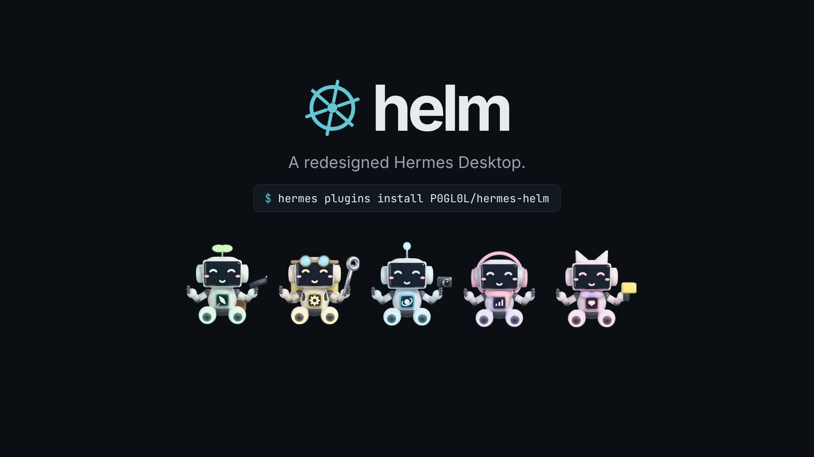
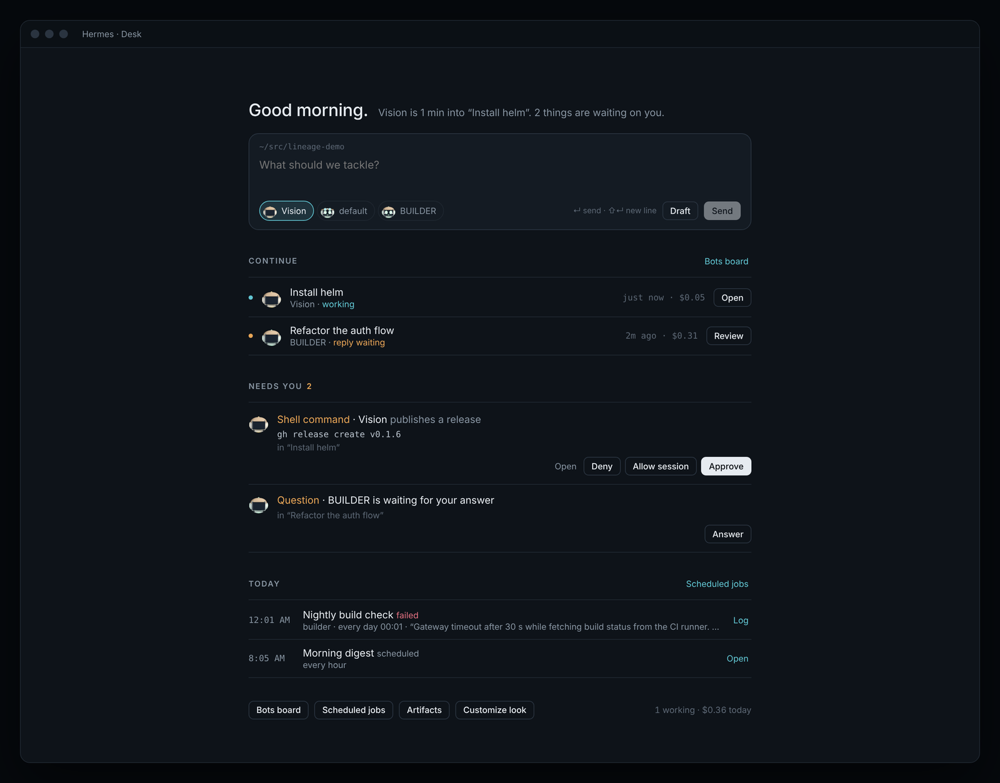
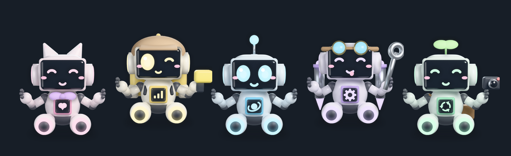

# helm

A redesigned Hermes Desktop, as a plugin. helm replaces the look of the whole app and adds the views Hermes doesn't have: a **Desk** that opens on what's running, what needs you and what ran today; live status for every bot across the sidebar, titlebar and status bar; a **Customize look** page that tunes the entire interface; and a crew of rendered robots that become your bots' Hermes avatars.


**Launch film (33 s):** [](https://github.com/ASV-Labs/hermes-helm/releases/latest/download/helm-launch.mp4)

```
hermes plugins install helm            # from the Hermes plugin catalog
# or straight from GitHub:
hermes plugins install ASV-Labs/hermes-helm
hermes plugins enable helm
```

Then in Hermes Desktop: **Settings → Plugins → Desktop plugins → enable helm**, and restart Hermes once so the gateway mounts helm's small backend (it serves the robot renders). Pick a look in **Customize look** (`⌘⌥U`).

| Desk | Bots board |
|---|---|
|  |  |

## What you get

| | |
|---|---|
| **Desk** (`⌘⌥0`, opens at launch) | A greeting and a one-line status of the crew (*Vision is 4 min into "deploy package". Two things are waiting on you.*), a prompt that hands work to any bot (pick its robot, ↵ sends, *Draft* fills the new chat unsent), **Continue** (latest sessions across every bot with state, folder, age, cost), **Needs you** (unread replies, with an inline reply that opens the chat with your reply drafted), **Today** (scheduled jobs that ran, failed or are due today), and shortcuts. |
| **Needs you** | Pending tool approvals from every bot's live chats, with *Approve* / *Allow session* / *Deny*, questions a bot is waiting on, and unread replies: on the Desk and in a sidebar pane above Sessions that appears only while something waits. Nothing is answered without your click. |
| **Continue strip** | On a fresh chat, the three latest sessions sit above the composer, one click back in, plus *N need you · Desk*. |
| **Redesign layer** | Across the whole app: one-colour rail, tracked-caps section labels and tabs with an accent underline, an accent edge on the open row, a calmer reading column, framed tool activity, approvals with an amber decision edge, a hairline composer that lights on focus, tabular status bar, hairline menus and dialogs, thin scrollbars. |
| **Customize look** | One page for the whole desk, applied live: base (Dark, Graphite, Paper), 7 accents, 4 type families, corners, reading width, rail colour, session density, chat text size, and every helm surface on or off. |
| **Session pane** | Right sidebar, beside Files: the focused chat's task plan (*Plan · 3 of 5*, the current step marked), bot, model, folder, branch, messages, tool calls, tokens, cost, the rest of the crew, the next scheduled job. |
| **Live status everywhere** | Titlebar: bot, folder, model, cost and context of the chat you're in. Session rows: the owning bot's robot (its face is the row's state) and spend. Status bar: *N need you*, *$ today*, *N working*, focused cost. |
| **Bots board** (`⌘⌥R`) | Every bot with its robot and live status (*reply waiting*, *working*, *idle · 12m ago*), needs-you-first, latest session with *Resume*, *New chat*, spend, and the look editor. *New bot* creates a real Hermes bot. |
| **Robots** | 191 PNG layers rendered in Blender (Cycles), composed live: 10 toppers · 10 faces · 8 chest modules · 6 tools · 6 things to wear · 7 colours. Each robot becomes its bot's Hermes avatar; new bots get one automatically unless you uploaded a photo. |
| **Palette** | *Desk*, *what needs me*, *new chat with <bot>*, *resume <bot>*, every theme. |
| **Settings** | Settings → Plugins → Helm, plus export/import of everything as JSON. |

## What it will not do

- Replace core views. The Desk is its own page; chats, Scheduled jobs and Bot Mode are the app's own.
- Send anything you didn't send. The Desk prompt sends only on ↵ or *Send*; *Reply* only drafts.
- Reorder the sidebar's Pinned / Projects sections.
- Overwrite a bot avatar you uploaded yourself.

## How the robots are served

The package has two halves. `desktop/plugin.js` is the UI. `dashboard/plugin_api.py` is a tiny FastAPI router the Hermes gateway mounts at `/api/plugins/helm/`; it serves the PNG layers in `dashboard/sprites/` as data URLs (`/sprites/batch?names=…`). The desktop half asks for the six layers a look needs, caches them, and stacks them as ``s. If the gateway is down or the routes aren't mounted yet (a restart mounts them), the board falls back to flat SVG robots so nothing breaks. The renderer is in `tools/render/` and is never run by Hermes. To rebuild the layers, use Python 3.13 with Blender's `bpy` 5.2 module, Pillow and NumPy, then run `python3 tools/render/build_all.py dashboard/sprites` (about 7 minutes on an M-series Mac) and `python3 tools/render/shrink.py dashboard/sprites`. `render_one.py` previews a single bot.

## Surviving updates

helm lives in `~/.hermes/desktop-plugins/helm/` (or `plugins/helm/desktop/`), which `hermes update` never touches. It uses only `@hermes/plugin-sdk` areas; the one app-DOM dependency is the themes' `customCSS`, which targets `data-slot` names the app ships. If a release renames one, that rule stops applying and the palette alone remains. Preferences are in `ctx.storage` under `hermes.plugin.helm.`; **Export** copies them as JSON.

Requires Hermes ≥ 0.22.0 (declared as `requires_hermes` in `plugin.yaml`). Tested on macOS.

## Disclosure

The agent half (`__init__.py`) registers nothing: no tools, hooks, commands or settings. The dashboard half is read-only and does one thing: it serves the bundled PNGs (names validated against a fixed pattern; no path traversal, no writes, no imports of Hermes internals). No outbound network requests. No shell. No credentials: helm never reads `.env`, `auth.json` or any token store. No telemetry. Reads the profile list through `host.profiles.list()` (the same endpoint the profile rail uses), each bot's recent session rows (title, timestamps, unread/active flags, cost) through `host.listPersistedSessions` — the sidebar's own read, kept in memory only — and the app's busy/usage state through `host.state`. Lists each bot's scheduled jobs for the Desk's *Today* list through the gateway's public `cron.manage` (`action: list` only — helm never adds, pauses or removes a job). Listens to the app's gateway event stream (`host.onEvent`) for approval, question and plan events, lists live sessions and their pending approvals (`session.active_list`, `approval.pending`), and answers an approval or question (`approval.respond`, `clarify.respond`) only when you click *Approve*, *Allow session*, *Deny* or *Send*. Reads the focused chat's transcript (`session.history`) to show its task plan, in memory only. Opens sessions and chats only when you click; sends a message only from the Desk prompt when you press ↵ or *Send*. Creates a bot (`profiles.create`) only from *New bot*, and sets a bot's avatar (`profiles.set_asset`) to its robot, never over a photo you uploaded. Writes otherwise only to its own plugin storage and, when you change them, the app's `sessionListDensity` and `chatTextScale` settings. The redesign layer is CSS supplied through the SDK's theme `customCSS`; it selects the app's `data-slot` names (CSS only — helm never queries, observes or rewrites the app's DOM), and it switches off with the theme.

## Development

```
node --check desktop/plugin.js
cd tests && npm ci && npm test     # loads the plugin against an SDK mock and renders every contribution
python3 tests/test_plugin_api.py   # the sprite router against FastAPI's TestClient
hermes plugins validate .          # the catalog's admission checks
```

Drop the folder into `~/.hermes/desktop-plugins/helm/` and the app hot-reloads it on save.

MIT · ASV Labs
