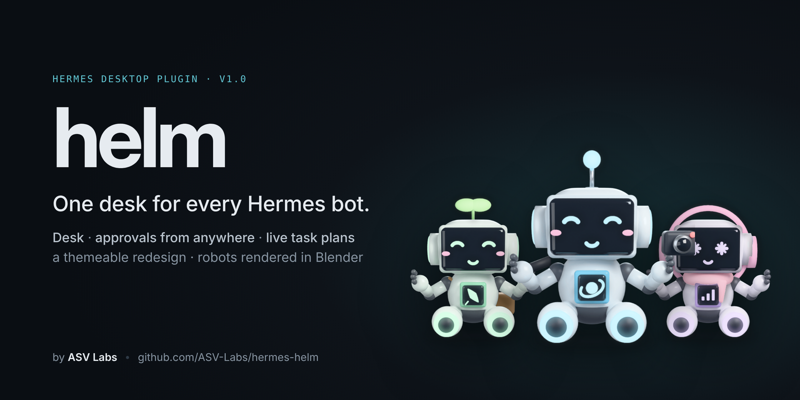
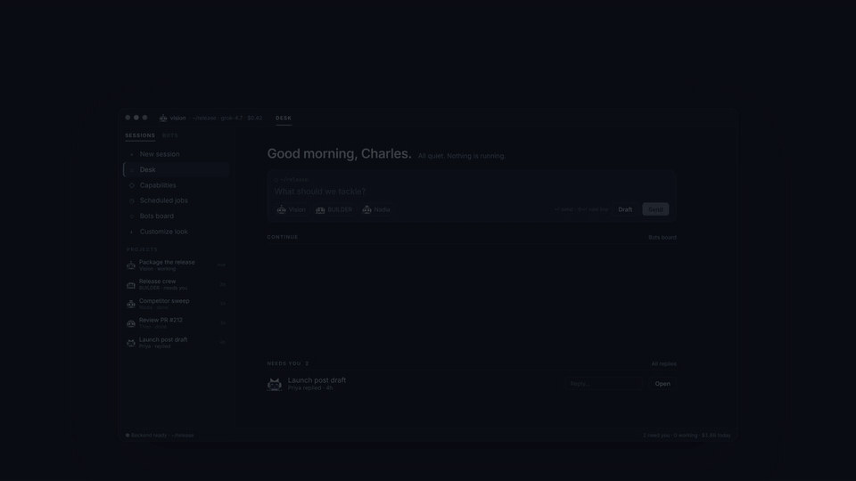
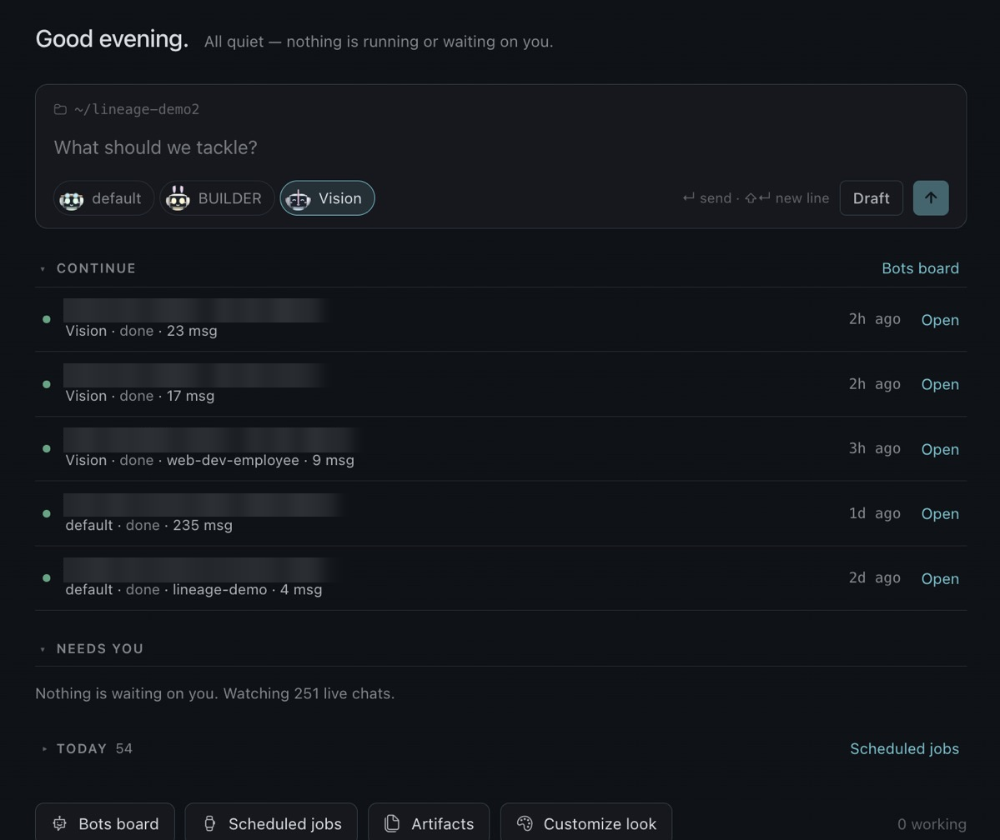
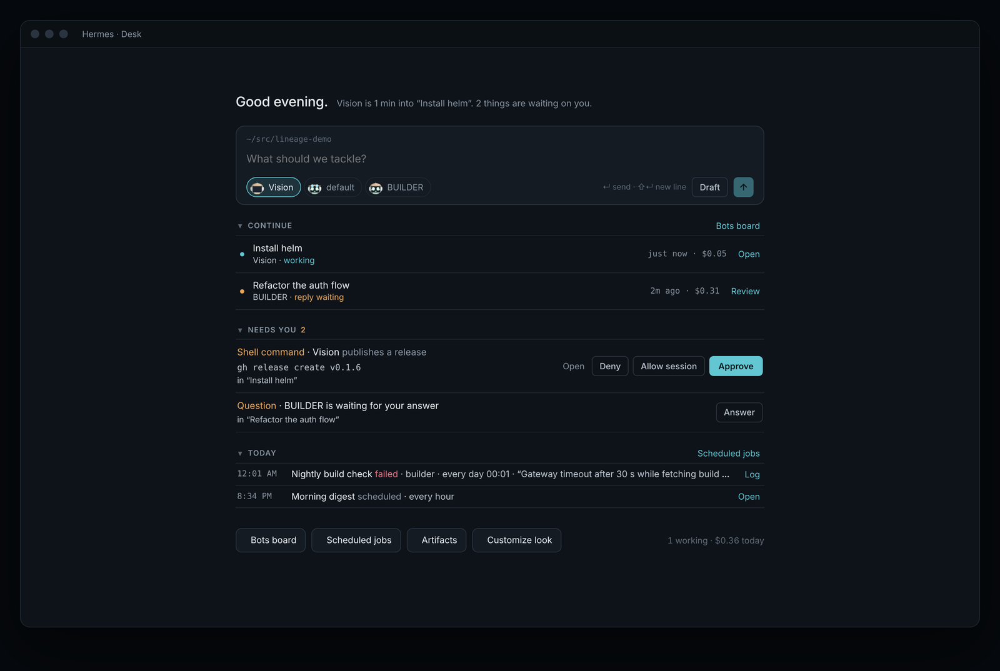
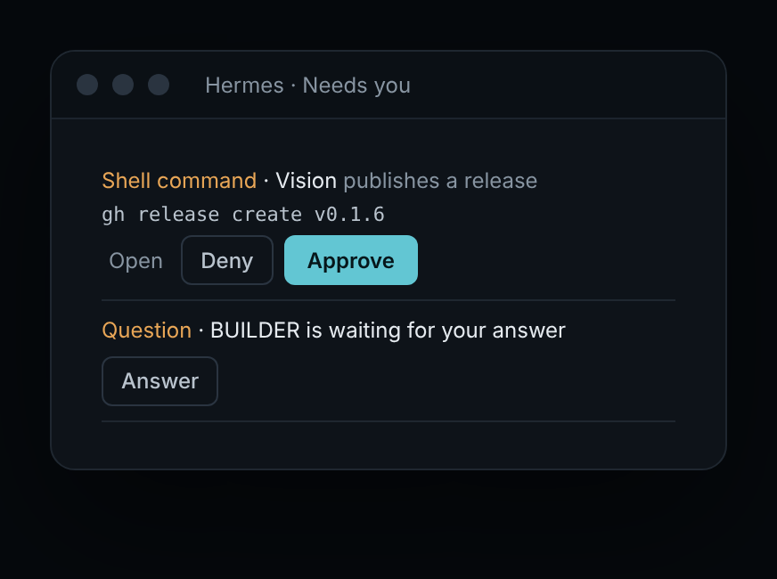
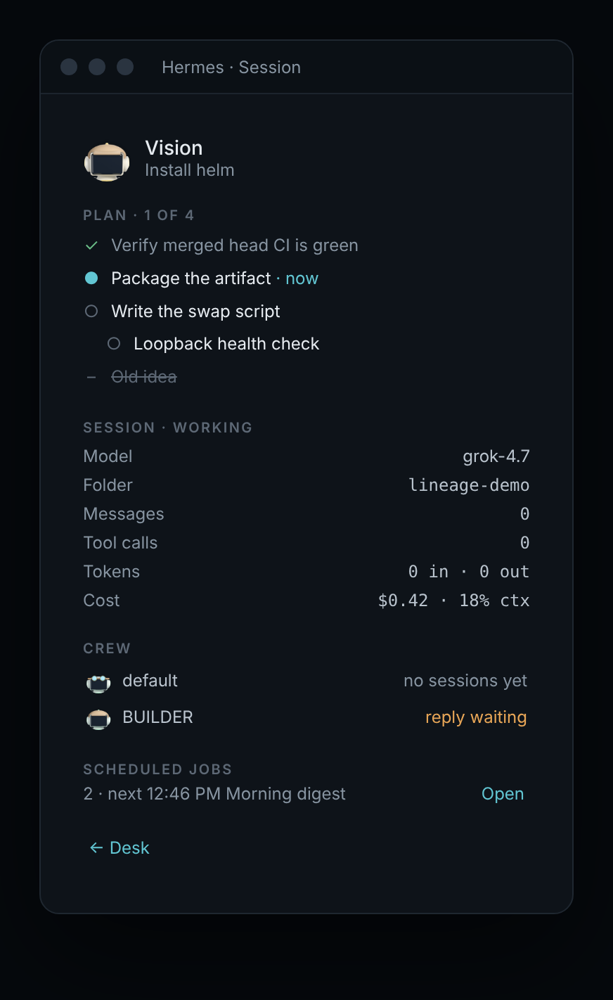
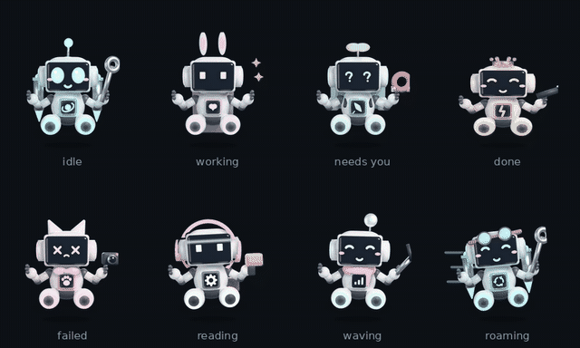
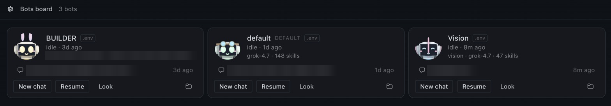
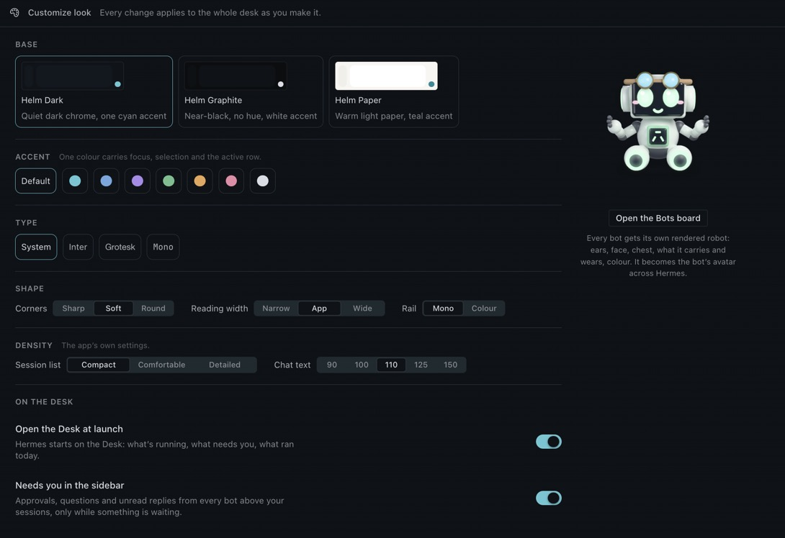

[](https://github.com/ASV-Labs/hermes-helm/releases/latest)
[](https://github.com/ASV-Labs/hermes-helm/actions/workflows/ci.yml)


[](LICENSE)
[](https://asv-labs.com)

**A complete redesign of Hermes Desktop, shipped as a plugin.** See what every bot is doing, answer what's waiting on you, and follow the plan as it happens — from one desk.

[Install](#install) · [What's inside](#whats-inside) · [Guides](docs/guides/README.md) · [Launch film](https://github.com/ASV-Labs/hermes-helm/releases/latest/download/helm-launch.mp4) · [Privacy](#privacy-and-permissions)



---

## Why helm

Running several Hermes bots means opening chat after chat to find out who is busy, who finished and who is waiting on you. helm turns Hermes Desktop into a control desk:

- **One place for what needs you.** Tool approvals and questions from every bot's live chats, answered with one click.
- **One glance at the crew.** Who is working, who replied, what it cost, what ran today.
- **A plan you can watch.** The focused bot's task list, checked off live beside the chat.
- **An interface you can make yours.** A redesign layer across the whole app, tuned on one page.

helm uses the public Hermes Desktop plugin SDK and the gateway calls the app itself makes (plus, in Hermes's HUD window only, the native bridge for the HUD's own settings). It passes the catalog's desktop-surface check, changes no Hermes core files and never answers anything without your click.

## Install

```bash
hermes plugins install ASV-Labs/hermes-helm
hermes plugins enable helm
```

Then in Hermes Desktop:

1. **Settings → Plugins → Desktop plugins → enable helm.**
2. **Restart Hermes once**, so its gateway mounts helm's small backend for the robot renders.
3. Press **`⌘⌥U`** and pick a look.

Requires **Hermes ≥ 0.22.1**. The step-by-step version, including updating, backing up your setup and uninstalling, is in **[Getting started](docs/guides/getting-started.md)**.

> **Official Hermes plugin catalog.** helm is listed in the catalog ([NousResearch/hermes-agent#150160](https://github.com/NousResearch/hermes-agent/pull/150160)), so `hermes plugins install helm` works too. The catalog pins one reviewed commit; it moves to a new release once that release passes `hermes plugins validate`, so the GitHub install above can be a version ahead.

## What's inside

### The Desk — `⌘⌥0`

Hermes opens on the Desk.

- **Greeting:** a one-line status of the whole crew.
- **Prompt**, pinned to the bottom like a chat: hands work to any bot. **↵** sends; **Draft** opens the chat with your text unsent. **+ New bot** builds a new bot with its own robot.
- **Continue:** your latest sessions across every bot.
- **Needs you:** approvals, questions and unread replies.
- **Today:** scheduled jobs that ran, failed or are due. It shows the five that matter most, and *Show all* lists the rest.

Each section folds: click its header, and the Desk remembers your choice. A folded section shows its count.



*Captured from Hermes Desktop with chat titles blurred. Here is the same Desk with an approval and a question waiting:*



### Needs you, everywhere — and the live plan

Approvals and questions from every bot appear on the Desk. They also appear in a sidebar pane, which shows up only while something is waiting.

The **Session** pane beside your chat shows the bot's task plan as it works (*Plan · 1 of 4*, with the current step marked *now*), along with model, folder, tokens, cost and the rest of your crew.

| Needs you — [what each button sends](docs/guides/needs-you.md) | Session pane — [where the plan comes from](docs/guides/task-plan.md) |
|---|---|
|  |  |

### Robots you build — `⌘⌥R`

The **Bots board** lists every bot with its rendered robot and live state (*working*, *reply waiting*, *idle*), its latest session and its spend.

**The robots are animated.** Each look becomes a full sprite sheet: idle breathing and blinking, working with sparks flying, a curious head-tilt while it waits on you, a jump when a job finishes, a slump and a puff of smoke when something fails, a scan line while it reads, and a wave when you point at it. The same sheet becomes the bot's **Hermes pet**, the animated companion on your desktop. It's built to the standard petdex/Codex format, so it works anywhere Hermes shows pets.



Each robot is assembled from **191 Blender-rendered layers**: toppers, faces, chest modules, tools, things to wear and seven colours. Its face follows the bot's state, and the robot becomes the bot's Hermes avatar. helm never replaces a photo you uploaded. **New bot** creates a real Hermes bot. → [Robots guide](docs/guides/robots.md)




### A redesign you can tune — `⌘⌥U`

The redesign layer runs across the whole app:

- a one-colour rail
- tracked-caps labels and tabs with an accent underline
- an accent edge on the open row
- a calmer reading column
- framed tool activity
- approvals with an amber decision edge
- a hairline composer that lights up on focus
- a tabular status bar
- thin scrollbars

**Customize look** tunes all of it live:

- **Base:** Dark, Graphite or Paper
- **Accent:** seven accents
- **Type:** four type families
- **Layout:** corners, reading width and rail colour
- **Density:** session list density and chat text size
- **Surfaces:** every helm surface can be switched on or off



→ [Customize look guide](docs/guides/customize-look.md)

### Status everywhere

- **Titlebar:** bot, folder, model, cost and context of the chat you're in.
- **Session rows:** the owning bot's status line and spend; **All / Needs you / Working / Done** pills at the top of each bot's session group filter the list.
- **Status bar:** *N need you*, *$ today*, *N working* and the focused chat's cost.
- **HUD:** in Hermes's HUD window, who is on, what waits on you and the latest reply, above the HUD composer.
- **Command palette:** *Desk*, *what needs me*, *new chat with ‹bot›*, *resume ‹bot›*, every theme and *Helm: diagnostics*.

Title-bar tabs keep Hermes's own look: the tab strip has no plugin slot, so helm does not draw status dots there.

## Guides

The guides cover the details specific to helm: what it can and can't see, and what to do when something looks off.

| | |
|---|---|
| [Getting started](docs/guides/getting-started.md) | Install, first run, shortcuts, updating, backup and uninstall |
| [Needs you](docs/guides/needs-you.md) | Approvals and questions: what each button sends, and coverage across gateways |
| [Session pane & task plan](docs/guides/task-plan.md) | Where the plan comes from and why a chat can show "No plan yet" |
| [Customize look](docs/guides/customize-look.md) | Themes, accents, toggles, and what happens after a Hermes update |
| [Bots board & robots](docs/guides/robots.md) | Robots, avatars, flat-robot fallback, rebuilding the renders |
| [Troubleshooting](docs/guides/troubleshooting.md) | Symptoms and fixes, and how to read *Helm: diagnostics* |

## Launch film

[](https://github.com/ASV-Labs/hermes-helm/releases/latest/download/helm-launch.mp4)

The film is attached to the latest GitHub release as `helm-launch.mp4`. If the link 404s, that release's assets have not been uploaded yet; the [releases page](https://github.com/ASV-Labs/hermes-helm/releases) has the last one that carries it.

## Privacy and permissions

helm is built to be audited. `hermes plugins validate .` runs the catalog's checks against it; the Desktop half passes the SDK-surface check (no `document.querySelector` on the app's markup, no observers on `document.body`, no dynamic code).

- **No network calls of its own.** No telemetry, no shell, no self-updater.
- **No credentials.** helm never reads `.env`, `auth.json` or any token store.
- **Nothing is sent or answered without you.** The Desk prompt sends only on **↵** / **Send**. Approvals, questions, routines, approval mode, bot settings and stops change only when you click.
- **Agent half:** registers nothing (no tools, hooks or commands).
- **Dashboard half:** a small router. It serves the bundled PNGs and the robots' sprite sheets, and makes one kind of write: each bot's robot pet, in that bot's own `pets/` folder.

### Every call helm makes

The agent half (`__init__.py`) registers nothing: no tools, hooks, commands or settings.

The dashboard half does three things.

- **Serves the bundled PNGs**, with names validated against a fixed pattern.
- **Serves a look's animated sprite sheet** (`/pets/sheet`). A look is six part names, each checked against the fixed part lists before anything is drawn.
- **Saves a bot's robot as its Hermes pet** (`/pets/install`). This is its only write: `pet.json` and `spritesheet.webp` in `<that bot's home>/pets/helm-<bot>/`, the standard pet layout Hermes reads.
  - The bot name must match Hermes's profile-name pattern.
  - The bot's home is found with Hermes's public `hermes_constants` helpers and must already exist.

It has no path traversal and imports no Hermes internals.

**Reads** (gateway calls the app itself makes; per-bot reads go through the SDK's profile-scoped `host.requestProfile`)

- The profile list, through `host.profiles.list()`. This is the same endpoint the profile rail uses.
- Each bot's recent session rows (title, timestamps, unread/active flags, cost), through `host.listPersistedSessions`. This is the sidebar's own read, and helm keeps it in memory only.
- The app's busy/usage state, through `host.state`.
- Each bot's scheduled jobs, through the gateway's public `cron.manage` with `action: list`.
- Live sessions and their pending approvals, through `session.active_list` and `approval.pending`.
- The focused chat's transcript (`session.history`), to build its task plan. helm keeps this in memory only.
- The window's approval mode and, per bot, a few settings (`config.get` on `approvals.mode`, `terminal.backend`, `tts.provider`, the chosen voice, `bot_desktop.placement`), and which MCP servers a bot has on (`mcp.servers.status`), for the Bot view's permissions and voice rows.
- A bot's profile for the editor (`profiles.describe`: description, SOUL.md, skills, model), only while the editor is open.
- A bot's computer, in the Bot view's **Computer** tab only while it is open: `display.status` and a `display.thumbnail` every 2.5 s (the same view Hermes's own Bots tab shows).
- Each bot's avatar (`profiles.get_asset`), once a minute, and its pet state (`pet.gallery`) once per look, for the robot avatar and pet features below.

**Listens**

- The app's gateway event stream (`host.onEvent`), for approval, question, plan, tool, handoff and `message.complete` events. The HUD's *Latest from* line is the text of the last `message.complete` event, trimmed to 1 200 characters and kept in plugin storage; helm does not read the transcript's markup.

**Acts only when you click**

- Answers an approval or question (`approval.respond`, `clarify.respond`) when you click *Approve*, *Allow session*, *Deny* or *Send*.
- Opens sessions, chats, Hermes's pages and its own tabs (`host.openSession`, `host.newChat`, `host.navigate`, `host.openWorkspace`, `host.revealPane`); puts text in the composer (`host.composer`) and focuses it; pages the transcript and focuses the composer through the app's own actions (`ctx.runAction`: `composer.focus`, `conversation.scrollPageUp`).
- Sends a message from the Desk prompt when you press **↵** or *Send*.
- Stops the focused chat's turn (`session.interrupt`) from **Stop**.
- Changes the window's approval mode (`config.set` on `approvals.mode`) from the composer's approval pill — *Ask before acting*, *Smart approvals* or *Act without asking*; the last one turns tool approvals off for that window, exactly as Hermes's own status-bar control does.
- Pauses or resumes a bot's scheduled job (`cron.manage` with `pause` / `resume`) from the on/off switch in the Bot view's routines. helm never adds or removes a job.
- Creates a bot (`profiles.create`) from *New bot*, and duplicates one (`profiles.create` with `clone_from`) from *Duplicate*.
- Saves a bot's description, disabled skills, model and provider, or SOUL.md (`profiles.configure`) from the bot editor's *Save*; an expensive model asks again before it saves.
- Starts a bot's computer (`display.start`) from the Computer tab's *Start*.
- Sets a bot's avatar (`profiles.set_asset`) to its robot, but never over a photo you uploaded.
- Restarts the gateway (`host.restartGateway`) from the button on the flat-robots notice.
- Makes each bot's robot its Hermes pet when **Robots as Hermes pets** is on:
  - It writes the pet folder described above.
  - It switches a bot to that pet with Hermes's own `pet.select`, but only if the bot has no pet. It checks this with `pet.gallery`.
  - It never replaces a pet you chose and never turns pets back on for a bot.

**Writes**

- Its own plugin storage.
- The app's `sessionListDensity`, `chatTextScale` and `reasoning.collapsedByDefault` settings, when you change them on Customize look or the chat header.

**Native bridge** (`window.hermesDesktop`, HUD window only)

Hermes's HUD has no SDK door yet, so in that window helm reads the HUD's own settings through the raw bridge: `hud.setBounds` sizes the HUD window to 440 × 720 once and `hud.close` closes it; `screenshot.getSettings` / `onStatus` show whether **See my screen** is on; `quickEntry.getSettings` shows the summon shortcut. Nothing else is read through the bridge, and nothing in the main window uses it.

**Styling and markup**

The redesign layer is CSS supplied through the SDK's theme `customCSS`; it selects the app's `data-slot` names in CSS only (`validate` warns on those selectors), and switches off when you switch to another theme. From script, helm draws only its own elements (SDK slots, its rail and HUD board) and sets `data-helm-*` attributes on the root element. It never selects, observes or edits the app's own elements, with four measurement-only reads it discloses: it reads the root element's `data-hermes-theme` attribute to restore a helm theme another plugin switched away at launch; it measures the composer's frame and the main zone's header to place its chips and rail; it checks whether the pointer is over the sessions zone for *collapse under 1100 px*; and its health check tests whether three of the app's markers still exist so it can name what a Hermes update moved.

## How it fits together

| Part | Role |
|---|---|
| `desktop/plugin.js` | The interface, written against `@hermes/plugin-sdk` only. |
| `dashboard/plugin_api.py` | A small FastAPI router that the gateway mounts at `/api/plugins/helm/`. It serves the robot layers in `dashboard/sprites/` and the sprite sheets, and saves a bot's robot pet. |
| `dashboard/pet_sheet.py` | Animates the layers into a 1536×1872 petdex/Codex sprite sheet: 9 rows, one per state, in 192×208 frames. Pure Pillow; the same look always gives the same sheet. |
| `__init__.py` | The agent half. It registers nothing. |
| `tools/render/` | The Blender source that produced the layers. Hermes never runs it. |
| `tools/screens/` | Re-renders the README screenshots from the real components, using demo data. |

helm lives in `~/.hermes/desktop-plugins/helm/`, which `hermes update` never touches. Preferences live in plugin storage under `hermes.plugin.helm.`, and you can export or import them in **Settings → Plugins → Helm**.

## Development

```bash
node --check desktop/plugin.js
cd tests && npm ci && npm test     # loads the plugin against an SDK mock and renders every contribution
python3 tests/test_plugin_api.py   # the sprite router against FastAPI's TestClient
hermes plugins validate .          # the catalog's admission checks (desktop surface: 0 refusals)
bash tools/screens/render.sh       # re-render docs/screens from the real components
```

Drop the folder into `~/.hermes/desktop-plugins/helm/` and the app hot-reloads it on save. See [CONTRIBUTING.md](CONTRIBUTING.md) to contribute and [SECURITY.md](SECURITY.md) to report a vulnerability.

---

**helm** is made by **[ASV Labs](https://asv-labs.com)** — independent software, made with intent.

© 2026 A Salty Vet, a product of ASV Labs · MIT License · Not affiliated with Nous Research.
